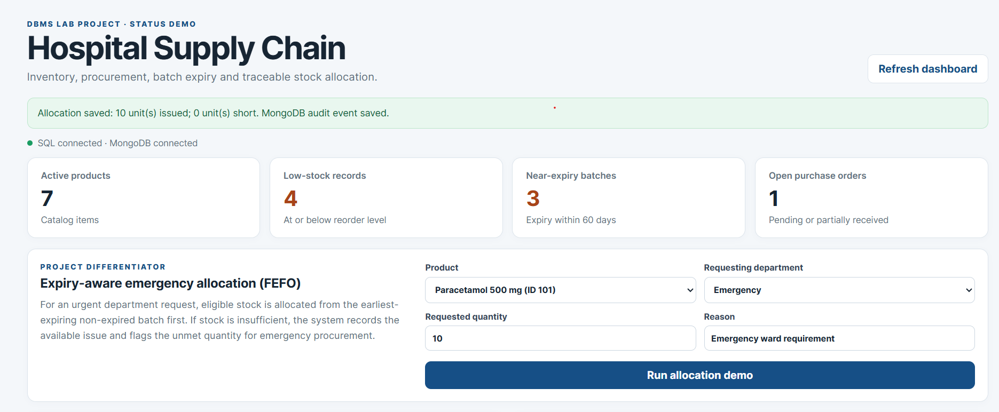
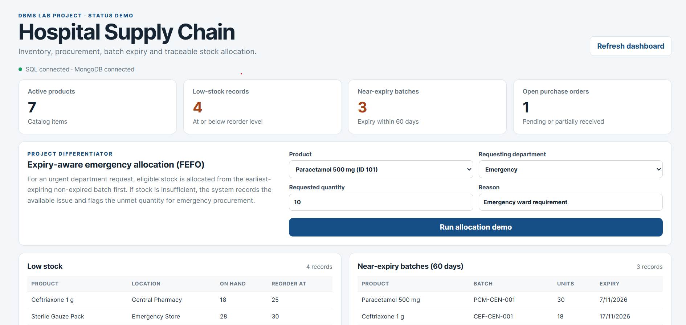
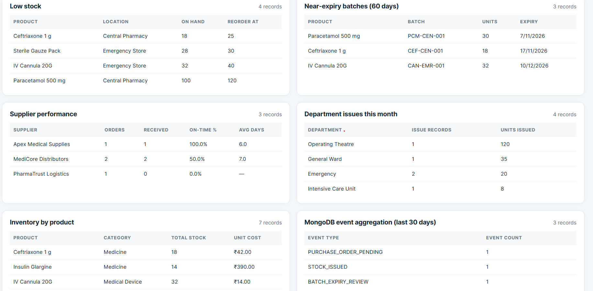
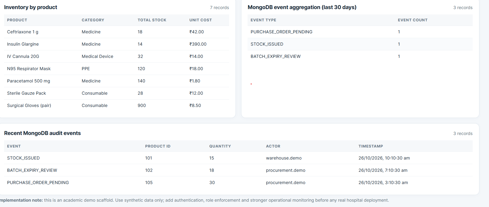

# Hospital Supply Chain Management System

**DBMS Experiential Learning – Level 3 project**  
**Team:** Rohit Chaki (PES1UG24AM228) · Rufus Thomas (PES1UG24AM232)

A web-based database application for managing hospital supplies across suppliers, warehouses, and departments. The system covers product and inventory records, batch-level expiry tracking, procurement, stock receiving, department allocation, warehouse transfers, emergency requests, role-based access, and operational reporting.

The application uses **MySQL** for structured transactional records and **MongoDB** for flexible audit/event documents. **Next.js 14** provides the browser interface and API Route Handlers.

> This is an academic demonstration using synthetic data only. Do not enter real patient, staff, or hospital operational data.

## Contents

- [Features](#features)
- [Technology stack](#technology-stack)
- [Roles and permissions](#roles-and-permissions)
- [Project structure](#project-structure)
- [Requirements](#requirements)
- [Setup on Windows](#setup-on-windows)
- [Run and test](#run-and-test)
- [Demo accounts](#demo-accounts)
- [Screenshots](#screenshots)
- [Database design and documentation](#database-design-and-documentation)
- [Security and limitations](#security-and-limitations)
- [GitHub collaboration](#github-collaboration)

## Features

| Area | Implementation |
|---|---|
| Inventory | Product catalogue, aggregate stock by warehouse, and batch-level quantities/expiry dates. |
| FEFO allocation | Selects eligible, non-expired batches by earliest expiry date; records issues in the stock-movement ledger. |
| Shortage handling | Issues available eligible stock, records the shortfall, and raises an emergency request/alert. |
| Procurement | Supplier-linked purchase orders, line items, partial/full receipt, and stock-batch creation. |
| Warehouse transfers | Transfers stock between warehouses while preserving batch expiry information. |
| Expiry monitoring | Near-expiry alerts and expired-stock write-off. |
| Reporting | Low stock, near expiry, supplier performance, department issues, inventory, purchase orders, and movements. |
| Audit | MongoDB `audit_events` records and aggregation for operational events. |
| Authentication | Scrypt password hashes, signed HttpOnly session cookie, and API-side role authorization. |

## Technology stack

| Technology | Purpose |
|---|---|
| MySQL 8.0.16+ | Relational operational data, keys, constraints, views, triggers, procedures, indexes, and transactions. |
| MongoDB | Flexible audit/event documents and aggregation. |
| Node.js 18.17+ | JavaScript runtime. |
| Next.js 14 / React 18 | Web UI and API Route Handlers. |
| `mysql2` | MySQL connection pool. |
| MongoDB Node.js driver | MongoDB connection and audit writes. |

## Roles and permissions

| Action | Admin | Procurement Officer | Warehouse Manager | Department Staff |
|---|:---:|:---:|:---:|:---:|
| View dashboard and reports | Yes | Yes | Yes | Yes |
| Allocate stock | Yes | — | Yes | Own department only |
| Transfer between warehouses | Yes | — | Yes | — |
| Create purchase orders | Yes | Yes | — | — |
| Receive purchase orders | Yes | Yes | Yes | — |
| Raise emergency request | Yes | — | Yes | Own department only |
| Convert emergency request to purchase order | Yes | Yes | — | — |
| Expiry scan / expired-stock write-off | Yes | — | Yes | — |

The permission matrix is defined in `lib/security.js` (re-exported by `lib/auth.js`) and enforced by the API routes. Hiding a UI control is not treated as the security boundary.

## Project structure

```text
app/
  api/
    allocate/          FEFO issue and shortage workflow
    auth/              login, logout, current-session endpoints
    emergency/         emergency requests and procurement conversion
    maintenance/       expiry scan and expired-stock write-off
    purchase-orders/   order creation and receiving
    reports/           dashboard and reporting data
    transfers/         warehouse transfer workflow
  globals.css
  layout.js
  page.js               dashboard and application interface

lib/
  audit.js              MongoDB audit-event writer
  auth.js               API authorization wrapper and compatibility exports
  security.js           password hashing, session signing, role-permission matrix
  mongo.js              MongoDB client/database access
  mysql.js              MySQL connection pool

sql/
  schema.sql            database, tables, keys, constraints, views, routines, triggers
  seed.sql              synthetic demonstration records
  reports.sql           reporting queries

mongodb/
  seed.js               audit collection/indexes and demo events
  aggregation_examples.js

docs/
  ER_Diagram.png        team-supplied ER diagram used in the report
  ER_Diagram_Detailed.* detailed implementation-oriented diagram and source
  DEMO_RUNBOOK.md
  EXPECTED_DEMO_RESULTS.md
  PROJECT_STATUS.md
  TESTING.md
  CONTRIBUTIONS.md
  REPOSITORY_CHECKLIST.md
  VIVA_CHEAT_SHEET.md
  screenshots/

report/
  Hospital_Supply_Chain_DBMS_Project_Report.pdf
  Hospital_Supply_Chain_DBMS_Project_Report.docx

tests/
  auth.test.js            password hashing and role-permission unit tests
```

The team-supplied `ER_Diagram.png` is a simplified presentation diagram. It does not show every implemented relation; the implementation-oriented diagram is retained as `ER_Diagram_Detailed.png`, and `sql/schema.sql` is the authoritative source for the relational schema. See `docs/ER_DIAGRAM_NOTES.md`.

## Requirements

- Node.js 18.17 or later
- MySQL 8.0.16 or later (the schema uses CHECK constraints)
- MongoDB Community Server or MongoDB Atlas
- npm

## Setup on Windows

Run these commands from the repository root in PowerShell.

### 1. Configure the environment

```powershell
Copy-Item .env.example .env
```

Open `.env` and set the MySQL password, MongoDB URI, and a strong unique `AUTH_SECRET`. Generate a random secret with:

```powershell
node -e "console.log(require('crypto').randomBytes(32).toString('hex'))"
```

Do not commit `.env`. The repository contains `.env.example` with placeholders only.

### 2. Create and seed the MySQL database

**Warning:** `sql/schema.sql` drops and recreates the `hospital_supply_chain` database. It is intended for this synthetic academic demo. Back up anything important before running it.

```powershell
cmd /c "mysql -u root -p < sql\schema.sql"
cmd /c "mysql -u root -p hospital_supply_chain < sql\seed.sql"
```

Alternatively, execute `sql/schema.sql` and then `sql/seed.sql` in MySQL Workbench. Confirm the database and tables exist before continuing.

### 3. Start MongoDB and seed audit events

Start your local MongoDB service (or configure an Atlas connection in `.env`), then run:

```powershell
npm ci
npm run mongo:seed
```

### 4. Start the application

```powershell
npm run dev
```

Open `http://localhost:3000` in your browser. The dashboard should indicate whether the SQL and MongoDB connections are available.

## Run and test

```powershell
# Unit tests for password hashing and role-permission behavior
npm test

# Compile the Next.js production build
npm run build

# Run the production server after a successful build
npm start
```

The automated tests do not replace database integration testing. Use `docs/TESTING.md` to record the MySQL, MongoDB, authentication, FEFO, procurement, transfer, expiry, and reporting checks completed on the demonstration machine.

## Demo accounts

All seeded demo accounts use the same demonstration password: **`Demo@123`**.

| Username | Role |
|---|---|
| `admin.demo` | Admin |
| `procurement.demo` | Procurement Officer |
| `warehouse.demo` | Warehouse Manager |
| `emergency.demo` | Department Staff |

These credentials are for the synthetic local demo only. Change or remove them before any deployment beyond the academic demonstration.

To generate a new password hash:

```powershell
npm run hash-password -- "YourNewPassword"
```

Update the corresponding `users.password_hash` value in your local database.

## Screenshots

The screenshots below were supplied as project demo evidence. They show the dashboard, allocation interaction, summary reports, and MongoDB event reporting.









The values shown are a captured demo snapshot and may change after reseeding or further transactions.

## Database design and documentation

- `sql/schema.sql` contains the MySQL database definition and advanced database objects.
- `sql/seed.sql` contains synthetic seed data.
- `sql/reports.sql` contains the reporting queries used by the project.
- `mongodb/seed.js` prepares the audit collection and sample events.
- `mongodb/aggregation_examples.js` contains example event aggregation pipelines.
- `docs/DEMO_RUNBOOK.md` gives a suggested evaluation walkthrough.
- `docs/EXPECTED_DEMO_RESULTS.md` describes expected values after a fresh seed.
- `docs/VIVA_CHEAT_SHEET.md` summarizes design decisions and likely viva questions.
- `docs/TESTING.md` provides a repeatable verification checklist.
- `docs/CONTRIBUTIONS.md` must be completed with the team's actual division of work.
- `report/` contains the project report in PDF and editable DOCX formats.

## Security and limitations

- Use synthetic data only. This project is not suitable for production hospital deployment.
- MySQL is the source of truth for structured operational records. MongoDB stores flexible audit/event documents.
- A successful SQL commit and the subsequent MongoDB audit write are **not** one distributed atomic transaction. An audit write can fail after the SQL operation has committed.
- The application uses scrypt password hashes and HMAC-SHA256 signed HttpOnly session cookies. Development can use a local fallback secret; production refuses to sign sessions unless `AUTH_SECRET` is configured with at least 32 characters. Never share that secret.
- HTTPS, password reset, production-grade account lockout, centralized secret management, and a transactional outbox/retry mechanism are outside the current academic demo scope.

See [`SECURITY.md`](SECURITY.md) for handling credentials and deployment limitations.

## GitHub collaboration

After creating an empty GitHub repository, connect this project folder and push it:

```powershell
git init
git add .
git commit -m "Initial commit: Hospital Supply Chain DBMS project"
git branch -M main
git remote add origin https://github.com/<owner>/<repository>.git
git push -u origin main
```

Replace the remote URL with the actual repository URL. If the repository is already initialized or has commits, do not re-run `git init`; inspect `git status` and `git remote -v` first.

To let the teammate push changes, open the repository's **Settings → Collaborators** (or **Collaborators and teams**) and invite their GitHub username with **Write** access. Both members should make commits under their own GitHub accounts and review `docs/CONTRIBUTIONS.md` before submission.
